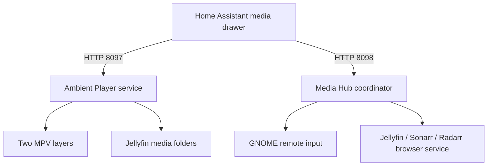

# Installation Handoff

## System map



The ambience player has no Jellyfin API token and does not require a Jellyfin plugin. Its integration is the shared media storage: it plays video and audio from the ambience folders that also belong to the Jellyfin library. The coordinator opens a local browser page for Jellyfin, Sonarr, or Radarr and sends constrained D-pad, keyboard, mouse and scroll input through GNOME Mutter.

## 1. Home Assistant

1. Install the five HACS cards listed in `README.md`.
2. Copy `home-assistant/www/homehub-media-ui/` to `/config/www/homehub-media-ui/`.
3. Add each entry in `home-assistant/frontend-resources.yaml` as a Dashboard resource with type **module**.
4. Put the four files from `home-assistant/packages/` in `/config/packages/` and configure package loading with `home-assistant/configuration-packages-snippet.yaml` if packages are not already enabled.
5. Replace every `YOUR_UBUNTU_HOST_IP`, `YOUR_SAMSUNG_TV_IP`, `YOUR_MEDIA_KEYBOARD_HOST`, `YOUR_MEDIA_KEYBOARD_SHARED_SECRET`, and `your_*` entity placeholder.
6. Add `home-assistant/dashboard/decluttering-templates.yaml` to the dashboard's global `decluttering_templates` configuration. The standalone `media-view.yaml` then has no weather-page dependency.
7. Add the contents of `home-assistant/dashboard/media-view.yaml` as a Manual card, or integrate it into the desired view.
8. Optionally add `home-assistant/dashboard/theme-snippet.yaml` to the active theme so the original glass styling variables are defined.
9. Restart Home Assistant and reload the browser once to refresh the custom-card modules.

The package `homehub_media_controller.yaml` includes Samsung and ESP32 bridge features from the original setup. Remove the related cards/scripts if the recipient only wants the Ubuntu Media Hub and ambience controls.

## 2. Ubuntu prerequisites

This backend is designed for an Ubuntu GNOME desktop session running on the HDMI media PC. The coordinator uses the GNOME/Mutter D-Bus remote-input API, so the user must be logged into the graphical session and the browser must run in that same session.

Install the runtime packages:

```bash
sudo apt update
sudo apt install mpv python3-gi gir1.2-glib-2.0
```

Create the intended media directories, or choose different paths and update both the ambience JSON and the `ReadOnlyPaths=` lines in the ambience service:

```bash
sudo install -d -o "$USER" -g "$USER" \
  /srv/homehub/jellyfin-media/library/Ambience/Videos \
  /srv/homehub/jellyfin-media/library/Ambience/Soundtracks
```

Point Jellyfin's library setup at the media root if the recipient wants the same ambience videos/music to appear in Jellyfin. Copy only media they are permitted to share; no media files are included in this bundle.

## 3. Install the ambience player

```bash
sudo install -d /opt/ambient-player /etc/ambient-player
sudo install -m 0755 ubuntu/ambient-player/ambient_player.py /opt/ambient-player/ambient_player.py
sudo install -m 0644 ubuntu/ambient-player/audio_only.ppm /opt/ambient-player/audio_only.ppm
sudo install -m 0644 ubuntu/ambient-player/config.example.json /etc/ambient-player/config.json
mkdir -p ~/.config/systemd/user ~/.local/state/ambient-player
install -m 0644 ubuntu/systemd-user/ambient-player.service ~/.config/systemd/user/ambient-player.service
```

Edit `/etc/ambient-player/config.json` and replace every `YOUR_` value. `allowed_clients` must include the Home Assistant server's LAN IP; `bind_host` must be the Ubuntu PC's LAN IP. Add optional aliases, profiles, and HTTPS radio stream URLs after the base service works.

Validate and start it from the Ubuntu graphical user session:

```bash
python3 /opt/ambient-player/ambient_player.py --config /etc/ambient-player/config.json --check
systemctl --user daemon-reload
systemctl --user enable --now ambient-player.service
curl http://127.0.0.1:8097/health
```

## 4. Install the coordinator

```bash
sudo install -d /opt/homehub-media-hub /etc/homehub-media-hub
sudo install -m 0755 ubuntu/media-hub-coordinator/media_hub_coordinator.py /opt/homehub-media-hub/media_hub_coordinator.py
sudo install -m 0644 ubuntu/media-hub-coordinator/coordinator.example.json /etc/homehub-media-hub/coordinator.json
install -m 0644 ubuntu/systemd-user/homehub-media-hub-coordinator.service ~/.config/systemd/user/homehub-media-hub-coordinator.service
```

Edit `/etc/homehub-media-hub/coordinator.json`:

- Set `listen_host` and `allowed_clients` to the recipient's own Ubuntu and Home Assistant IP addresses.
- Set the Jellyfin/Sonarr/Radarr local URLs and the names of the user services that launch them in the graphical session.
- Keep `ambient_stop_url` local: `http://127.0.0.1:8097/v2/stop`.

Create one browser service for each configured client by copying `ubuntu/systemd-user/browser-client.service.template`. Replace the app name, browser executable, and local URL; save the result as the same unit name used in `coordinator.json`, for example `jellyfin-browser.service`.

Then start the coordinator:

```bash
systemctl --user daemon-reload
systemctl --user enable --now homehub-media-hub-coordinator.service
curl http://127.0.0.1:8098/health
```

## 5. End-to-end checks

1. From Home Assistant, run the ambience catalog refresh or start one visual.
2. Confirm `http://YOUR_UBUNTU_HOST_IP:8097/health` is reachable from Home Assistant.
3. Press **Watch** in the Media Hub drawer. The coordinator must stop ambience and launch Jellyfin in the browser service.
4. Use the D-pad. Use the mouse-pad to move, click, and scroll inside the browser.
5. Press **Series** and **Movies** to test the included Sonarr/Radarr HA scripts and their matching browser services.

## Privacy changes made for this bundle

- Removed specific LAN addresses from all distributed files.
- Removed the saved ESP32 keyboard hostname and shared key.
- Replaced home-specific device, light, cover, scene, and media-player entity IDs with `your_*` placeholders.
- Made the ambience player's former fixed network allowlist configurable.
- Excluded user configuration, saved state, media content, preview images, service recovery files, logs, and system inventory.
