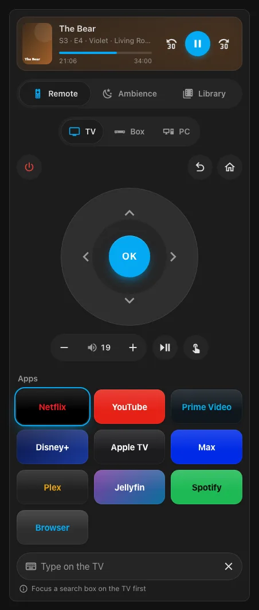
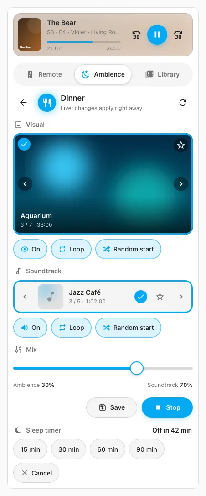
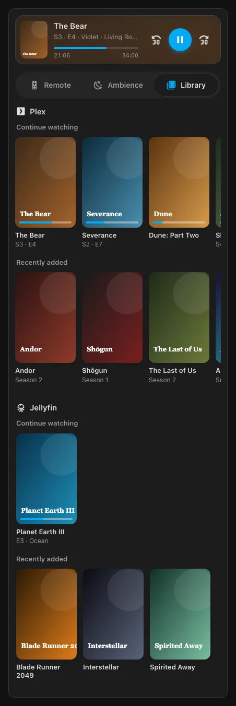
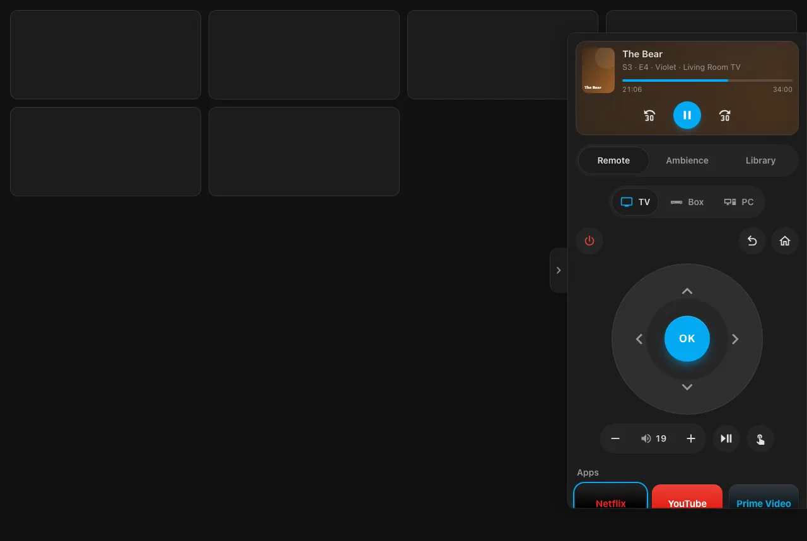

# HomeHub Media

[](https://github.com/hacs/integration)
[](https://github.com/alws34/ha-homehub-media/releases)
[](https://github.com/alws34/ha-homehub-media/actions/workflows/validate.yml)
[](LICENSE)

Control a Samsung TV, run ambience (video, soundtrack and lights), and browse Plex and Jellyfin from Home Assistant, with one Lovelace card.

| Remote | Ambience | Library | Drawer |
|---|---|---|---|
|  |  |  |  |

## Features

- **Samsung TV control** over your local network. It does not need the core Samsung TV integration.
  - Power, D-pad, OK, back, home, volume, mute, play, pause, stop, rewind, fast forward, channel up and down, guide, menu, info, exit, and raw Samsung keys.
  - Launch or restart Netflix, YouTube, Prime Video, Disney+, Apple TV, Max, Plex, Jellyfin, Spotify, Twitch, Paramount+, and the TV's Browser.
  - Type into the TV's on-screen keyboard, and use a touchpad pointer in the TV browser.
- **Ambience**: a looping video (visual) and a separate soundtrack per mode, from local files, YouTube videos, or internet radio.
  - A mode can pick a random video from several each time it starts.
  - A mode can switch on a lighting scene and flicker chosen lights like a fire. The previous lighting comes back when the mode stops. If Home Assistant restarts while a mode runs, the previous lighting cannot be restored, because the snapshot is kept only in memory.
  - Change the visual or soundtrack while a mode runs, mark favourites, and mix the two volumes.
  - Sleep timer that fades out, and time-of-day auto ambience.
- **Plex and Jellyfin**: Continue Watching and Recently Added rows. Tap a title to open the app on the TV and play it. A Now Playing strip shows the current session with play or pause, rewind, and fast forward buttons.
- **Activities**: Off, Samsung TV, Streaming box, or Media PC. Switching to an activity turns the TV on, switches the TV input for the box or PC, sets the TV volume, and stops ambience that plays video or sound. Off turns the TV and box off and stops all ambience.
- **Optional devices**: a streaming box on a TV input, an Ubuntu media PC for ambience and browser apps, and an ESP32 Bluetooth keyboard bridge.
- **Voice assistant**: a conversation agent that uses Ollama, OpenAI, or Claude. You pick the provider and model. HomeHub's tools are also available to Home Assistant's own Ollama, OpenAI, and Anthropic agents.
- **Blueprints** for stopping ambience when the TV changes, quiet hours, and sunset ambience.
- **One card** (`homehub-media-card`) with no third-party card dependencies. It follows the light or dark theme.

## Requirements

- Home Assistant 2026.9.0 or newer.
- [HACS](https://hacs.xyz/).
- A Samsung TV with Tizen OS on the same network as Home Assistant, reachable by IP address or host name.

Optional: Plex, Jellyfin, a streaming box, a media PC, an ESP32 keyboard bridge, and an OpenAI or Claude API key (or a local Ollama server) for the voice assistant. To play Plex titles from the card, you also need the core Plex integration (see [TV limitations](#tv-limitations)).

## Installation

1. In HACS, open the **⋮** menu (top right) and choose **Custom repositories**.
2. Enter `https://github.com/alws34/ha-homehub-media`, set **Category** to **Integration**, and select **Add**.
3. Find **HomeHub Media**, select **Download**, and restart Home Assistant.
4. Go to **Settings › Devices & services › Add integration** and choose **HomeHub Media**.
5. Enter the TV's host name or IP address and select **Submit**. The fields are filled in if the Samsung Smart TV integration is set up.
6. Make sure the TV is on. On the next screen select **Submit**, then press **Allow** on the TV within 30 seconds.

Or use these buttons from the Home Assistant instance you want to use:

[](https://my.home-assistant.io/redirect/hacs_repository/?owner=alws34&repository=ha-homehub-media&category=integration)
[](https://my.home-assistant.io/redirect/config_flow_start/?domain=homehub_media)

Notes:

- Only one HomeHub Media entry can be set up.
- HomeHub pairs its own client, named **HomeHub**, with the TV. It does not change the Samsung TV integration's connection.
- The TV's MAC address is optional. With it, HomeHub can turn the TV on with Wake-on-LAN. If you leave it empty, HomeHub reads it from the TV.
- To change the TV's address later, open the integration's **⋮** menu and choose **Reconfigure**. You pair with the TV again.
- The first time HomeHub finds the TV on, it checks which streaming apps are installed.

## Configuration

Open **Settings › Devices & services › HomeHub Media › Configure**. Every section is optional. Pick a section and submit your changes, which returns you to the menu. Choose **Save and close** to apply all changes. Closing the dialog without it discards them.

| Menu item | What it configures |
|---|---|
| **TV** | Optional TV media player, an entity whose state is the current app, and the Home Assistant URL the TV uses to show ambience (empty uses the internal URL). The TV media player is used to switch inputs by source name, turn the TV on and off, and read and set the volume. When it is set, the remote's power, volume, and mute buttons and the card's volume slider go through it (for example the core Samsung TV integration's player) instead of TV key presses. |
| **Streaming apps** | Which apps appear on the remote, optional TV app ID overrides as `app=id` pairs, and a rescan of installed apps. |
| **Plex and Jellyfin** | Plex URL and token (or copy both from the Plex integration), Jellyfin URL and API key, then the Jellyfin user. Each has an optional player name filter. The server is checked when you submit. Enables Continue Watching, Recently Added, and Now Playing. |
| **Streaming box** | The remote entity that controls the box, an optional media player for channels, and how the TV switches to the box's input. |
| **Media PC** | Host, ambient player and coordinator ports and tokens, how the TV switches to the PC's input, and the apps the PC may open. Both daemons are checked when you submit. See [media-pc/README.md](media-pc/README.md). |
| **Keyboard bridge** | Host and shared key of the ESP32 keyboard bridge. |
| **Ambience** | Where ambience plays (Samsung TV, or Media PC once the media PC is set up), internet radio stations for soundtracks, and YouTube videos for visuals (see [YouTube ambience](#youtube-ambience)). |
| **Ambience modes** | Add, edit, or delete modes: name, icon, lighting scene, flickering lights, and a lights-only switch. Eight starter modes are included: Fireplace, Dinner, Reading, Game Night, Chill, Starry Night, Movie Time (lights only), and Cat TV. A new mode's ID comes from its name, for example `game_night`, and stays the same if you rename it. |
| **Volume** | Normal volume (default 19) and quiet volume (default 10), which need the TV media player, plus an optional entity that, while it is on, blocks switching to any activity except Off. |
| **Times of day** | Start time and ambience mode for morning, afternoon, evening, and night (defaults 06:00, 12:00, 18:00, 22:00), and the idle time before auto ambience starts (default 10 minutes, 1 to 240). No mode is set by default, so auto ambience does nothing until you choose modes here. |
| **Voice assistant** | Provider (Ollama, OpenAI, or Claude, or None to turn it off), URL or API key, and model. |

Notes on secrets and addresses:

- Tokens and keys are never shown again after you save them.
- Leave a secret field empty to keep the saved value, but only while the address, port, or provider stays the same. If you change the address, enter the secret again.
- Plex needs a token (`X-Plex-Token`). Plex cannot be saved without one. Jellyfin needs an API key. The media PC needs both of its tokens.
- Leaving a device's host or URL empty turns that device off. For the streaming box, leave the remote empty.
- Switching inputs by source name needs the TV media player from the **TV** section. Switching by remote key, such as `KEY_HDMI1`, does not.

### Entities

| Entity | What it is |
|---|---|
| `select.homehub_media_ambience_mode` | Off, or one of your modes by ID. Selecting a mode starts it. Selecting Off stops ambience. |
| `select.homehub_media_activity` | Off and Samsung TV, plus Streaming box and Media PC when they are set up. |
| `switch.homehub_media_quiet_mode` | On sets the TV to the quiet volume, off sets it to the normal volume. Needs the TV media player. |
| `switch.homehub_media_auto_ambience` | Off by default. When on, it starts the mode for the current time of day once all of these are true: a mode is set for the current time of day, the activity is Samsung TV, the TV is on, no ambience is running, no Plex or Jellyfin session is playing, nothing has been sent through HomeHub for the idle time, and, if you set a current-app entity, it shows the home screen or no app. |
| `sensor.homehub_media_ambience_sleep_timer` | The time the sleep timer stops ambience. Unknown when no timer is set. |
| `sensor.homehub_media_now_playing` | The title of the current Plex or Jellyfin session. Attributes: `server`, `player`, `subtitle`, `state` (`playing` or `paused`), and `position` and `duration` in seconds. |
| `conversation.homehub_media_assistant` | The voice assistant, named **HomeHub Media Assistant**. Appears after you set a provider. |

## Ambience videos and soundtracks

HomeHub reads visuals and soundtracks from two folders and creates them automatically:

```text
/media/homehub/ambience/
├── videos/                    visuals, shown on the TV
│   ├── fireplace.mp4
│   ├── fireplace.webp         optional preview image
│   └── nature/
│       └── rain.mkv           sub-folders are scanned
└── soundtracks/               audio, played alongside a visual or on its own
    └── jazz_cafe.mp3
```

**Where the folder is**

- **Home Assistant OS**: the `media` share from the Samba share add-on (for example `\\homeassistant\media` on Windows or `smb://homeassistant/media` on macOS). You can also upload files in the **Media** panel under **My media**. The folders appear there once HomeHub has created them.
- **Other installs**: the `homehub/ambience` folder inside your local media folder. If you have not set one, that is the `media` folder in your config directory.

**Supported files**

| Kind | Folder | Extensions |
|---|---|---|
| Visuals | `videos` | `.mp4`, `.mkv`, `.webm`, `.mov` |
| Soundtracks | `soundtracks` | `.mp3`, `.ogg`, `.opus`, `.flac`, `.m4a`, `.wav` |

**Recommended video format**: H.264 video, AAC audio, MP4 container, up to 1080p, with `+faststart` so playback starts quickly. A file the TV cannot decode shows a black picture. To convert a file:

```bash
ffmpeg -i in.mkv -c:v libx264 -preset slow -crf 20 -c:a aac -b:a 160k -movflags +faststart out.mp4
```

To cap the output at 1080p, add `-vf "scale=-2:'min(1080,ih)'"` before `-c:v`.

**Preview images**: put an image with the same file name in the same folder as the video or soundtrack, for example `fireplace.webp`. Accepted types are `.webp`, `.jpg`, `.jpeg`, and `.png`. If more than one exists, they are tried in that order. Previews appear in the card's carousels.

**Names and IDs**

- The file name sets the ID and the title. The ID is the file name without its extension, in lowercase, with every run of characters other than `a`-`z` and `0`-`9` replaced by one `_`, leading and trailing `_` removed, and up to 64 characters. The title is the file name without its extension, with `_` shown as spaces. For example, `Rain Forest.mp4` gets the ID `rain_forest` and the title "Rain Forest".
- If two files produce the same ID, the second gets `_2`, and so on.
- IDs are assigned in sorted path order. Adding a file whose name produces the same ID as an existing file can change which file a saved mode uses. Check your modes after you add files.
- Sub-folders are scanned, but only the file name is used for the ID.
- Files and folders whose names start with a dot are ignored, including the `._` files macOS creates.
- After you add files, open a mode's editor in the card's **Ambience** tab and press the refresh button, or call `homehub_media.refresh_catalog`. HomeHub also scans the folders when it starts.

**Radio stations** (Samsung TV backend only): in **Configure › Ambience › Radio stations**, enter one station per line as `id=https://url`, for example `jazz=https://example.com/stream`. Use HTTPS only, and do not put a user name, password, or `#` fragment in the URL. Station IDs use lowercase letters, digits, `-`, and `_`, start with a letter or digit, and are up to 64 characters. Stations appear in the soundtrack list with a live label.

**Assign visuals and soundtracks to a mode**

1. Open the **Ambience** tab in the card.
2. Select the edit button (sliders icon) on the mode's tile. Lights-only modes have none.
3. Browse visuals and soundtracks with the arrows or by swiping, and tap one to use it. Set the on, loop, and random-start options and the mix.
4. Select **Save**.

If the mode is running, changes apply right away, but they are kept only after you select **Save**.

**Random from several videos per mode**: in the visual carousel, the shuffle button on a video adds it to the mode's rotation, and pressing it again removes it. When the rotation has videos, each start of the mode picks one of them at random, and the chosen visual is used only when the rotation is empty. A rotation can hold up to 50 videos and can mix local files and YouTube videos. The mode's tile shows "Random from N videos" when the rotation has two or more. Select **Save** to keep the rotation. In automations, `save_mode` and `ambience_update` take the rotation as `visuals`, a list of visual IDs.

**Media PC users**: if ambience plays on the media PC, the videos and soundtracks live on that PC. Follow [media-pc/README.md](media-pc/README.md). Preview images for the media PC go in Home Assistant's `www/Ambience` folder as `<id>.webp` or `<id>.png`.

## YouTube ambience

Samsung TVs from 2021 on do not let Home Assistant open the ambience page in the TV browser (see [TV limitations](#tv-limitations)). On those TVs, use YouTube videos as visuals. They play in the TV's own YouTube app.

**Add videos**

1. Open **Configure › Ambience**.
2. In **YouTube videos**, enter one video per line as `Name=link`, for example `Star night=https://www.youtube.com/watch?v=B5unCXpegAw`. Watch, share (`youtu.be`), Shorts, and live links work, and so do `m.youtube.com` and `music.youtube.com` links and a bare 11-character video ID. Extra link parameters such as `&pp=` are ignored.
3. Select **Submit**, then **Save and close**.

The videos appear in the card's visual carousel in the order you entered them, with their YouTube thumbnail and a "YouTube" label. The name is the title, and the ID comes from the name the same way as for files (`Star night` becomes `star_night`). A name without Latin letters, for example in Hebrew, gets `yt_` and the video ID in lowercase instead. If a local file already has that ID, the video gets `_2`, and so on. Assign a video to a mode like any other visual.

**What happens on the TV**

1. HomeHub switches the activity to Samsung TV and sets the mode's lights.
2. If YouTube is not on screen, HomeHub opens it.
3. HomeHub connects to YouTube as a remote, the way the YouTube app on a phone does ("Link with TV"), and asks it to play the video. The video always starts from the beginning, full screen.
4. When the video ends, HomeHub plays it again, so it loops for as long as the mode runs. YouTube's autoplay is turned off, so no other video follows.

The first time, HomeHub pairs with YouTube on its own: it reads the TV's YouTube screen ID while YouTube is open and links to it. You do not enter a code on the TV. The pairing is saved, and HomeHub pairs again by itself if YouTube forgets it.

When YouTube is already open, for example when you switch from one YouTube mode to another or pick another YouTube video in the editor while the mode runs, the new video replaces the old one in about 2 seconds, without closing YouTube. A cold start, with YouTube closed, takes longer while the app opens; HomeHub retries for about 20 seconds until YouTube reports that the video plays.

Notes:

- A YouTube video plays with its own sound. The mode's soundtrack, the mix, loop, and random-start settings are not used with a YouTube visual: the video always loops from the start. Set the volume with the TV.
- Without YouTube Premium, YouTube may show ads.
- If YouTube leaves the screen (you press HOME, open another app, or turn the TV off), HomeHub notices within about a minute and a half (it checks every 30 seconds, after a one-minute grace period), stops the mode, and restores the lights. Stopping the mode closes YouTube.
- The sleep timer does not fade a YouTube video. It stops it at the end time.
- YouTube videos also work when ambience plays on the media PC. A YouTube mode then switches to Samsung TV, and a local-file mode switches back to the media PC.
- Home Assistant needs internet access: the remote connection goes through YouTube's servers.
- DIAL must be on (HomeHub reads the screen ID and closes YouTube over it). It is on by default on Samsung TVs.

## Card

The integration registers the card itself, so you do not add a Lovelace resource. After the first setup, refresh the browser once. On any dashboard, add the **HomeHub Media** card from the card picker, or add a **Manual** card and paste one of the examples below.

Card options:

| Key | Values | Default | Meaning |
|---|---|---|---|
| `drawer` | `true` or `false` | `false` | Slide-out panel fixed to the right edge of the screen, with a handle. Press Esc to close it. |
| `tabs` | any of `remote`, `ambience`, `library` | all three | Tabs to show, in this order. `library` appears only when Plex or Jellyfin is set up. |
| `default_tab` | `remote`, `ambience`, `library` | `remote` | The tab that opens first. If it is not in `tabs`, the first tab in `tabs` opens. |
| `target` | `tv`, `box`, `pc` | the current activity, or `tv` | The target selected in the remote. Falls back to the TV if the chosen target is not set up. |

An invalid value shows a configuration error on the card.

Inline card:

```yaml
type: custom:homehub-media-card
```

Drawer:

```yaml
type: custom:homehub-media-card
drawer: true
```

Show only the Ambience and Remote tabs, in that order, open on Ambience, and select the media PC as the target:

```yaml
type: custom:homehub-media-card
tabs: [ambience, remote]
default_tab: ambience
target: pc
```

## Services

All services are in the `homehub_media` domain. Fields in *italics* are optional.

| Service | Fields | What it does |
|---|---|---|
| `remote` | `command`, *`target`* | Presses a remote button. `command` is one of `up`, `down`, `left`, `right`, `select`, `back`, `home`, `power`, `play_pause`, `play`, `pause`, `stop`, `rewind`, `fast_forward`, `volume_up`, `volume_down`, `mute`, `channel_up`, `channel_down`, `guide`, `menu`, `info`, `exit`. `target` is `tv`, `box`, or `pc`, and defaults to the current activity (the TV when off). Volume and mute always go to the TV, and so does `power` sent to the PC. With the TV media player set in **Configure › TV**, the TV's `power`, `volume_up`, `volume_down`, and `mute` go through that player: `power` turns the TV off when it is on and on when it is off. Without it, `power` on a TV that is off sends Wake-on-LAN (needs the MAC address). The PC supports only the D-pad, `select`, `back`, `home`, play and pause, and `stop`. |
| `set_volume` | `level` | Sets the TV volume to `level` (0 to 100) through the TV media player from **Configure › TV**. Fails without one. |
| `send_key` | `key`, *`hold_secs`* | Sends a raw Samsung key such as `KEY_HDMI1` to the TV. `hold_secs` is 0 to 5. |
| `launch_app` | `app` | Opens an app on the TV by app key (`netflix`, `youtube`, `prime_video`, `disney_plus`, `apple_tv`, `max`, `plex`, `jellyfin`, `spotify`, `twitch`, `paramount_plus`, `browser`) or by TV app ID. Switches the activity to Samsung TV and stops ambience that plays video or sound. |
| `restart_app` | `app` | Closes and reopens an app on the TV. Same values as `launch_app`. |
| `send_text` | `text`, *`target`* | Types 1 to 200 printable characters. The media PC accepts at most 100, and only plain ASCII. `target` is `tv`, `pc`, or `keyboard`. Without it, text goes to the media PC when that is the activity, otherwise to the TV if its on-screen keyboard is open or no keyboard bridge is set up, otherwise to the keyboard bridge. |
| `keyboard_key` | `key`, *`target`* | Presses `backspace`, `enter`, or `clear`. `target` works as for `send_text`. The TV's on-screen keyboard supports only `enter`. |
| `pointer` | `action`, *`dx`*, *`dy`*, *`target`* | `action` is `move`, `click`, `right_click`, or `scroll`. `dx` and `dy` (-500 to 500) set the move distance, and `dy` sets the scroll amount. `target` is `tv` or `pc`, and defaults to the PC when that is the activity, otherwise the TV. The TV supports only `move` and `click`. |
| `set_activity` | `activity`, *`force`* | Switches to `off`, `tv`, `box`, or `pc`. With `force`, an input switch by source name is sent at least twice, for TVs that ignore the first one. |
| `channel` | `number` | Tunes the streaming box to a channel number of 1 to 4 digits. Needs the box's media player. |
| `ambience_start` | `mode` | Starts a mode by ID, for example `fireplace`. |
| `ambience_stop` | | Stops ambience and restores the lights. |
| `ambience_update` | *`visual`*, *`visual_enabled`*, *`video_loop`*, *`video_random_start`*, *`original_volume`*, *`soundtrack`*, *`soundtrack_loop`*, *`soundtrack_random_start`*, *`soundtrack_volume`*, *`visuals`* | Changes what the running ambience plays. `visual` and `soundtrack` are media IDs (a radio station ID works as a soundtrack). The volumes are 0 to 100. `visuals` is the mode's rotation, a list of up to 50 visual IDs (see [random from several videos](#ambience-videos-and-soundtracks)); changing it does not change the running video. Switching between a YouTube video and a local file starts the mode again. Works only while a mode with video or sound is running. |
| `save_mode` | `mode`, plus the `ambience_update` fields | Saves the fields as the mode's default. Fields you leave out get their defaults: no visual or soundtrack, an empty rotation, loop and random start on, video volume 20, soundtrack volume 100. |
| `set_favorite` | `kind`, `media_id`, `favorite` | Marks (`favorite: true`) or unmarks a `visual` or `soundtrack` as a favourite. |
| `ambience_auto` | | Starts the mode set for the current time of day. Fails if none is set. |
| `ambience_sleep_timer` | `minutes` | Stops ambience after `minutes` (0 to 600). 0 cancels the timer. Needs a running mode. |
| `refresh_catalog` | | Rescans the ambience folders (or the media PC) for visuals and soundtracks. |
| `rescan_apps` | | Asks the TV which streaming apps are installed. The TV must be on. Admin users only. |
| `play_library_item` | `server`, `item_id` | Opens Plex or Jellyfin on the TV and plays an item. `server` is `plex` or `jellyfin`, and `item_id` is the item's ID on that server. |
| `pc_open` | `client` | Opens an app on the media PC by its name, as listed in the Media PC options. Switches the activity to Media PC and stops ambience that plays video or sound. |
| `pc_close` | | Closes the app open on the media PC. |

Example automation that starts Dinner at 19:00 and stops it after 90 minutes:

```yaml
alias: Dinner ambience
triggers:
  - trigger: time
    at: "19:00:00"
actions:
  - action: homehub_media.set_activity
    data:
      activity: tv
  - action: homehub_media.ambience_start
    data:
      mode: dinner
  - action: homehub_media.ambience_sleep_timer
    data:
      minutes: 90
mode: single
```

The sleep timer fades the volume to zero during the last minute before the end time, and stops ambience at that time. The end time is shown in `sensor.homehub_media_ambience_sleep_timer`. Stopping ambience or starting another mode cancels the timer.

## Blueprints

Import a blueprint with the button, then create an automation from it.

| Blueprint | What it does |
|---|---|
| **HomeHub Media - stop ambience when the TV moves on** | Stops ambience and restores the lights when the entity you choose changes, for example the TV's source, current app, or play state. Changes in the first 30 seconds after ambience starts are ignored. |
| **HomeHub Media - quiet mode on a schedule** | Turns quiet mode on at one time and off at another (defaults 22:00 and 07:00). |
| **HomeHub Media - ambience at sunset** | At sunset (with an optional offset), if the TV media player you choose is off, starts the mode for the current time of day. |

[](https://my.home-assistant.io/redirect/blueprint_import/?blueprint_url=https%3A%2F%2Fraw.githubusercontent.com%2Falws34%2Fha-homehub-media%2Fmain%2Fblueprints%2Fautomation%2Fhomehub_media%2Fstop_ambience_on_app.yaml)
[](https://my.home-assistant.io/redirect/blueprint_import/?blueprint_url=https%3A%2F%2Fraw.githubusercontent.com%2Falws34%2Fha-homehub-media%2Fmain%2Fblueprints%2Fautomation%2Fhomehub_media%2Fquiet_mode_schedule.yaml)
[](https://my.home-assistant.io/redirect/blueprint_import/?blueprint_url=https%3A%2F%2Fraw.githubusercontent.com%2Falws34%2Fha-homehub-media%2Fmain%2Fblueprints%2Fautomation%2Fhomehub_media%2Fsunset_ambience.yaml)

## Voice assistant

You can use HomeHub's own assistant or your existing Ollama, OpenAI, or Anthropic agent.

**Option 1: HomeHub's assistant**

1. Open **Configure › Voice assistant**, choose a provider, and select **Submit**.
2. Enter the connection details and select **Submit**.
   - **Ollama** (local): enter the Ollama URL. No key.
   - **OpenAI** or **Claude**: enter an API key. Your requests go to that service.

   HomeHub installs the provider's software the first time, which can take a minute. Ollama uses the OpenAI client software.
3. Choose a model from the list, or type a model name, and select **Submit**.
4. Choose **Save and close**.
5. Go to **Settings › Voice assistants**, open your assistant, and select **HomeHub Media Assistant** as the conversation agent.

To remove the assistant, choose **None (turn off)** as the provider.

**Option 2: your existing agent**

Open the settings of your Ollama, OpenAI, or Anthropic conversation agent. Under **Control Home Assistant**, turn on the **HomeHub Media** API. The agent can then use HomeHub's tools.

The tools can open apps, press remote buttons on the current activity's device, switch activity, start a mode, start the mode for the current time of day, stop ambience, set the sleep timer, turn quiet mode on and off, play a Plex or Jellyfin title from Continue Watching or Recently Added by name, and report what is playing. They control only HomeHub.

Titles and session names from Plex and Jellyfin reach the language model as untrusted text. If other people can add media to your server (a shared Plex or Jellyfin library), do not turn on the HomeHub Media API in an agent that also has broad Assist control of your home, because a crafted title could try to steer that agent.

## TV limitations

These come from the TV, not from HomeHub.

- **Pointer**: the TV accepts pointer input only where Samsung enables it, such as the built-in Browser and some apps. There the card's touchpad moves the pointer and a tap clicks. Everywhere else on the TV the touchpad works as a swipe pad: every 48 pixels of swipe press an arrow key in the swipe's main direction, and a tap presses OK. The hint under the touchpad shows which mode is active, and the card remembers per browser whether you last used the D-pad or the touchpad. On the TV, only move and click are available. Scroll and right-click work on the media PC only.
- **Typing**: text goes to a text field that has focus on the TV. Focus a search box on the TV first. Without a focused field, HomeHub types through the ESP32 keyboard bridge if you set one up. Backspace and clear also need the keyboard bridge.
- **Deep links**: opening a specific Netflix or Disney+ title is not reliable and is not supported. Use the Plex or Jellyfin library to play a title.
- **App IDs**: the TV cannot list its apps on 2020 and newer models, so HomeHub tries a list of known IDs for each app. IDs vary by region and year. Some built-in IDs were checked on one Samsung QE55Q60B, and others may differ on your TV. If an app is missing or opens the wrong app, use **Streaming apps** to rescan or set the ID.
- **Plex and Jellyfin apps**: if the Plex or Jellyfin app is not installed on the TV, HomeHub opens that server's URL from **Plex and Jellyfin** in the TV browser instead.
- **Playing a library title**: HomeHub opens the app, then waits up to 15 seconds for it to accept remote play. Plex plays through a media player from the core Plex integration. If you have more than one Plex player, set the player name filter so HomeHub picks the TV. Jellyfin plays on the configured user's most recently active session that supports remote control and matches the player name filter.
- **Play and pause**: the remote's play/pause button sends play or pause to the TV and tracks the last key it sent, not the real player state. If playback changes without HomeHub, for example with the TV remote, the next press can do the wrong thing. The Now Playing strip uses the session's real state.
- **Browser player on 2021 and newer TVs**: Samsung TVs from 2021 on (Tizen 6.5 and newer, checked on a QE55Q60B) start the browser hidden when Home Assistant asks them to open a page. Local video and soundtrack files therefore cannot play on these TVs when ambience plays on the Samsung TV, and starting such a mode fails with "This TV does not allow opening web pages remotely". Use [YouTube ambience](#youtube-ambience) or play ambience on a media PC. Lights-only modes are not affected. For the same reason, a Plex or Jellyfin server URL cannot open in the browser on these TVs.
- **App launches**: HomeHub opens apps through the TV's REST interface, which answers at once. If the TV says the app is not installed, the launch fails with "… is not installed on the TV". Only when the REST interface itself fails does HomeHub send the launch over the remote connection, without waiting for a reply, because the TV never sends one.
- **Remote connection while the browser is open**: the TV can send pointer events before it accepts the remote connection. HomeHub ignores them while connecting, so button presses still work.
- **Autoplay**: when TV ambience starts in the browser, HomeHub presses OK on the TV about 4 seconds later, so the browser allows sound. If the sound stays muted, press OK on the TV remote.
- **Ambience page closed**: if the TV's ambience page stops checking in with Home Assistant, for example because the browser was closed or the TV turned off, HomeHub stops the mode within about a minute and restores the lights.

## Media PC

The media PC is optional. HomeHub Media does not install the Ubuntu side. Set it up with [media-pc/README.md](media-pc/README.md), which covers the user services, tokens, and firewall. Generate a separate token for each of the two daemons, and do not skip the firewall step: only Home Assistant should reach ports 8097 and 8098.

## Upgrading from the YAML bundle

HomeHub Media replaces the HomeHub Media Controller & Ambience bundle (YAML packages, custom cards, and a dashboard). This is a breaking change.

1. Remove the old bundle from Home Assistant:
   - the packages `homehub_media_controller.yaml`, `homehub_ambience_ui.yaml`, `homehub_ambient_player.yaml`, and `homehub_media_hub_pc_keyboard.yaml`, and the `packages:` line in `configuration.yaml` if nothing else uses it;
   - the `www/homehub-media-ui/` cards and their five dashboard resources;
   - the media dashboard (`media-view.yaml`), its decluttering templates, and the `Home Hub Media Glass` theme.

   Button Card, Decluttering Card, card-mod, Mushroom, and my-slider-v2 are no longer needed. Keep them only if other dashboards use them. Restart Home Assistant.
2. Install and set up HomeHub Media as described above.
3. Ambience profiles and favourites now live in Home Assistant and are not imported. Add any custom modes in **Configure › Ambience modes**. Then open each mode in the card, choose its visual and soundtrack, and select **Save** once. Mark your favourites again.
4. Update automations and scripts that used the old helpers and scripts to use the [entities](#entities) and [services](#services) above.
5. **Media PC users**: update both daemons and their systemd units from [media-pc/](media-pc/README.md). Both configs now need an `auth_token` of at least 32 characters (use a different one for each daemon), and the daemons refuse to start without one. Enter the tokens in **Configure › Media PC**. See [Upgrading from the YAML bundle](media-pc/README.md#upgrading-from-the-yaml-bundle) in the media PC guide. Preview images in `www/Ambience` keep working.

## Security

- Every service and WebSocket command goes through Home Assistant's authentication. Only signed-in users and authorised automations can call them. `rescan_apps` (it rewrites the integration options) is limited to admin users.
- The TV ambience page link is signed and tied to one ambience session. It stops working when that ambience stops. Links to ambience media files are signed and expire after 24 hours. Restarting Home Assistant revokes all signed links.
- Plex and Jellyfin tokens stay in Home Assistant. Artwork goes through an authenticated Home Assistant proxy, so the tokens never reach the browser or the TV.
- Titles from shared Plex or Jellyfin servers are untrusted text for the voice assistant. See [Voice assistant](#voice-assistant).
- **Media PC**: the daemons accept a request only if it comes from an allowed IP address, names a configured host, carries the bearer token, and sends a JSON body. Both require a token of at least 32 printable characters with no spaces. Give each daemon its own token, and do the required firewall step in [media-pc/README.md](media-pc/README.md) so only Home Assistant can reach ports 8097 and 8098.
- **ESP32 keyboard bridge**: HomeHub sends the shared key in clear text over plain HTTP, so anyone who can capture your LAN traffic can read it and type on the bridge. Your bridge firmware should compare the key in constant time, accept requests only from the Home Assistant IP address, and ideally require signed timestamps so a captured request cannot be replayed. Put the bridge on a dedicated IoT VLAN or SSID that only Home Assistant can reach.
- The media PC requests (including the bearer tokens) also use plain HTTP, and so do Plex and Jellyfin requests when the server URL starts with `http://`. Anyone who can capture traffic on your LAN can read these values. Keep the network trusted, or put these devices on a separate network segment that only Home Assistant can reach.
- Keys and tokens are stored in Home Assistant's configuration. Anyone with access to the Home Assistant config folder can read them.

## Troubleshooting

**The TV does not show a pairing prompt.** On the TV, go to **Settings › General › External Device Manager › Device Connection Manager › Access Notification** and select **First time only**. Then open the device list in the same menu, remove any old **HomeHub** entries, and run the setup again. Menu names can vary by model.

**An app tile is missing, or it opens the wrong app.** Go to **Configure › Streaming apps**, tick **Rescan TV apps**, and submit. Then submit again with the box unticked to save the result, and choose **Save and close**. You can also call `homehub_media.rescan_apps`. To set an ID by hand, use the App IDs field.

**The ambience screen is black.** Check that the video is H.264 video in an MP4 container, as described above. Check the TV's auto power-off setting, because a TV that turns itself off ends ambience. Check that the **Home Assistant URL for the TV** in **Configure › TV** is reachable from the TV.

**Library rows are empty.** Check the Plex or Jellyfin URL and token or API key in **Configure › Plex and Jellyfin**.

**A library title opens the app but does not play.** For Plex, set up the core Plex integration so the TV's Plex app appears as a media player. For Jellyfin, sign in to the TV app as the configured user. If you set a player name filter, check that it matches the TV.

**Enable debug logging.** Add this to `configuration.yaml`, restart or reload the logger, then check **Settings › System › Logs**:

```yaml
logger:
  default: warning
  logs:
    custom_components.homehub_media: debug
```

## Credits

HomeHub Media is based on the original HomeHub Media Controller & Ambience bundle by the original HomeHub author.

Released under the [MIT License](LICENSE).
